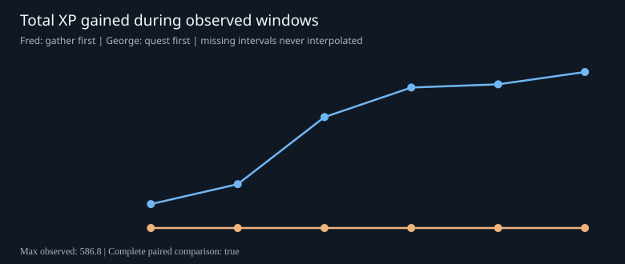
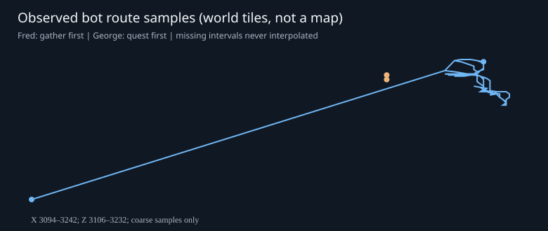

# Fred vs George — real-action 377 AB report

UTC hour: 2026-11-01T06:00:00Z to 2026-11-01T07:00:00Z
Status: **COMPLETE**; 12/12 bot intervals valid.
Two distinct bot policies (n=1 per arm): descriptive AB data, NOT a statistically powered causal result.

## Outcomes

| Metric | Fred (gather first) | George (quest first) |
|---|---:|---:|
| 10-minute reports | 6 | 6 |
| XP gained | 586.8 | 0.0 |
| Observed XP/hour | 586.8 | 0.0 |
| Successful actions | 697 | 1139 |
| Failed actions | 11 | 21 |
| Deaths | 0 | 0 |
| Solo-only XP | 586.8 | 0.0 |
| Coop/mixed XP | 0.0 | 0.0 |

## Last reported positions (at most ten-minute resolution)

- Fred: Lumbridge (x=3233, z=3230, plane=0); online at last sample: True
- George: Lumbridge (x=3204, z=3218, plane=0); online at last sample: True

## Skill XP earned this hour

| Skill | Fred | George |
|---|---:|---:|
| Attack | 16.0 | 0.0 |
| Defence | 0.0 | 0.0 |
| Strength | 0.0 | 0.0 |
| Hitpoints | 14.3 | 0.0 |
| Ranged | 0.0 | 0.0 |
| Prayer | 0.0 | 0.0 |
| Magic | 41.5 | 0.0 |
| Cooking | 0.0 | 0.0 |
| Woodcutting | 275.0 | 0.0 |
| Fletching | 0.0 | 0.0 |
| Fishing | 0.0 | 0.0 |
| Firemaking | 120.0 | 0.0 |
| Crafting | 0.0 | 0.0 |
| Smithing | 0.0 | 0.0 |
| Mining | 0.0 | 0.0 |
| Herblore | 0.0 | 0.0 |
| Agility | 0.0 | 0.0 |
| Thieving | 120.0 | 0.0 |
| Slayer | 0.0 | 0.0 |
| Farming | 0.0 | 0.0 |
| Runecrafting | 0.0 | 0.0 |

## Newly verified quest completions

- Fred: none observed
- George: none observed

## Bugs requiring investigation

- stall_george_Quest__Cook_s_Assistant_ (medium): George reported in 4 interval(s)

## Team cooperation

No cooperation events reported.

## Tracking gaps

All 12 expected bot-interval records received.

## Charts

No screenshots, credentials or family player telemetry are collected. Do not claim the bot is online from this report alone.
