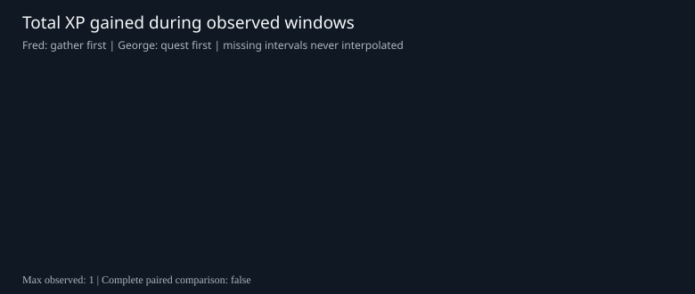
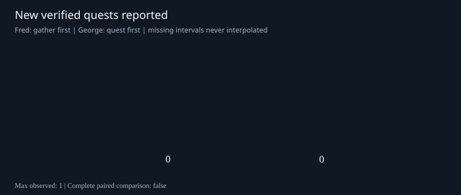
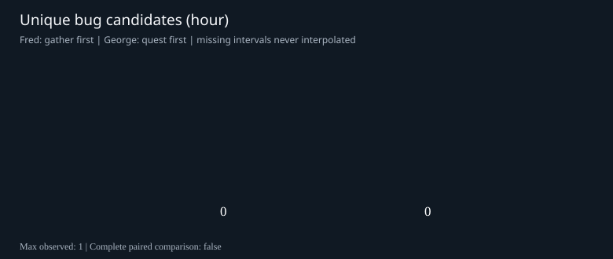
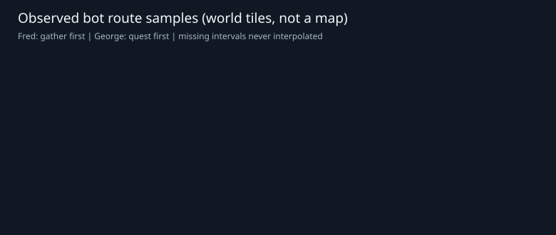

# Fred vs George — real-action 377 AB report

UTC hour: 2026-11-07T07:00:00Z to 2026-11-07T08:00:00Z
Status: **PARTIAL_OR_NOT_COMPARABLE**; 0/12 bot intervals valid.
Two distinct bot policies (n=1 per arm): descriptive AB data, NOT a statistically powered causal result.

## Outcomes

| Metric | Fred (gather first) | George (quest first) |
|---|---:|---:|
| 10-minute reports | 0 | 0 |
| XP gained | 0.0 | 0.0 |
| Observed XP/hour | None | None |
| Successful actions | 0 | 0 |
| Failed actions | 0 | 0 |
| Deaths | 0 | 0 |
| Solo-only XP | 0.0 | 0.0 |
| Coop/mixed XP | 0.0 | 0.0 |

## Last reported positions (at most ten-minute resolution)

- Fred: UNKNOWN (no sample received)
- George: UNKNOWN (no sample received)

## Skill XP earned this hour

| Skill | Fred | George |
|---|---:|---:|
| Attack | 0.0 | 0.0 |
| Defence | 0.0 | 0.0 |
| Strength | 0.0 | 0.0 |
| Hitpoints | 0.0 | 0.0 |
| Ranged | 0.0 | 0.0 |
| Prayer | 0.0 | 0.0 |
| Magic | 0.0 | 0.0 |
| Cooking | 0.0 | 0.0 |
| Woodcutting | 0.0 | 0.0 |
| Fletching | 0.0 | 0.0 |
| Fishing | 0.0 | 0.0 |
| Firemaking | 0.0 | 0.0 |
| Crafting | 0.0 | 0.0 |
| Smithing | 0.0 | 0.0 |
| Mining | 0.0 | 0.0 |
| Herblore | 0.0 | 0.0 |
| Agility | 0.0 | 0.0 |
| Thieving | 0.0 | 0.0 |
| Slayer | 0.0 | 0.0 |
| Farming | 0.0 | 0.0 |
| Runecrafting | 0.0 | 0.0 |

## Newly verified quest completions

- Fred: none observed
- George: none observed

## Bugs requiring investigation

No structured bug candidates received. This **does not** prove a bug-free world.

## Team cooperation

No cooperation events reported.

## Tracking gaps

- MISSING: Fred 2026-11-07T07:10:00Z
- MISSING: George 2026-11-07T07:10:00Z
- MISSING: Fred 2026-11-07T07:20:00Z
- MISSING: George 2026-11-07T07:20:00Z
- MISSING: Fred 2026-11-07T07:30:00Z
- MISSING: George 2026-11-07T07:30:00Z
- MISSING: Fred 2026-11-07T07:40:00Z
- MISSING: George 2026-11-07T07:40:00Z
- MISSING: Fred 2026-11-07T07:50:00Z
- MISSING: George 2026-11-07T07:50:00Z
- MISSING: Fred 2026-11-07T08:00:00Z
- MISSING: George 2026-11-07T08:00:00Z

## Charts

No screenshots, credentials or family player telemetry are collected. Do not claim the bot is online from this report alone.
