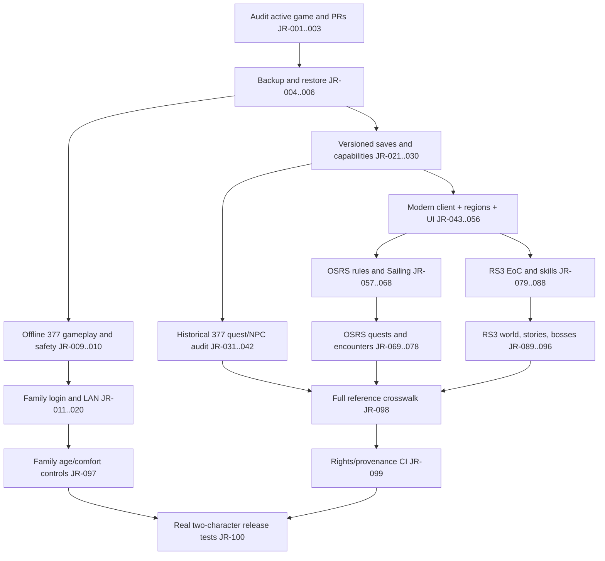

# Dependency graph and high-leverage engineering sequence

**Generated source:** [100-task JSON](data/implementation_backlog_first_100.json) and [228-edge graph](data/dependency_graph.json), checked 8 November 2026. All graph edges are proposed blocking dependencies, **not measured runtime facts**. The graph is acyclic by construction: earlier IDs feed later tasks. Its current longest *node-count* chain is **18 tasks**, but this does not predict calendar duration.

## Critical design paths

**Sailing:** `JR-021 -> 028 -> 043 -> 044 -> 055 -> 061 -> 062 -> 064 -> 065 -> 067` (profile identity → world/modern client → rendered boat → sea graph → hull → docking → charting → XP contracts). Crew/salvage branch from hull.

**RS3 abilities:** `JR-021 -> 027 -> 043 -> 050 -> 051 -> 079 -> 080 -> 081 -> 084` (client capability + server tick -> multi-slot UI -> RS3 rules -> abilities/adrenaline -> conjures). Combat behaviour can't be proven by a client-only cooldown animation.

**Quest mechanics:** `JR-021 -> 024 -> 029 -> 052 -> 069 -> 070 -> 078` (versioned quest vars, event atomicity, dialogue choice, prereqs, actual quest pipeline, live playthrough). All specific quests also need real NPCs, items, locations and optional instances.

**Safe family multiplayer:** `JR-002 -> 004 -> 005 -> 006 -> 009 -> 013 -> 014 -> 015 -> 016 -> 019 -> 020`. Production character data must not be used to skip isolated two-client tests.

## Approximate downstream reach (number of descendant work orders in the current DAG)

| Task | Descendants |
| --- | ---: |
| JR-001 — repository / PR baseline | 99 |
| JR-002 — read-only active host | 98 |
| JR-003 — pinned source hashes | 91 |
| JR-004 — save locations | 87 |
| JR-005 — verified snapshot | 84 |
| JR-006 — disposable restore | 82 |
| JR-021 — versioned game-profile identity | 75 |
| JR-009 — real 377 offline session | 73 |
| JR-025 — save migration/rollback | 67 |
| JR-027 — deterministic authoritative ticks | 60 |
| JR-043 — modern independent client prototype | 48 |

The figures above are reproducible **graph reachability**, not independently validated effort savings or actual team capacity. Connecting almost everything to P0 makes safety steps structurally central by design; this must not be interpreted as proof every feature technically requires one family host.

## Interpretation rules

A dependency edge means "normally establish acceptance of A before releasing B." A feature may be prototyped in a separate disposable world without passing the entire family-host gate. Dependencies may be revised following implementation evidence; retain old graph versions for traceability. Never mark a downstream task complete because its parent is present in source alone. For jobs running in parallel, agree interface contracts before shared-source edits.
